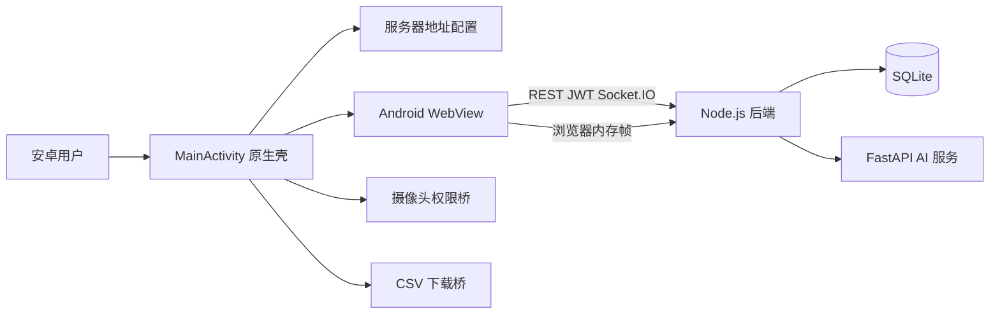
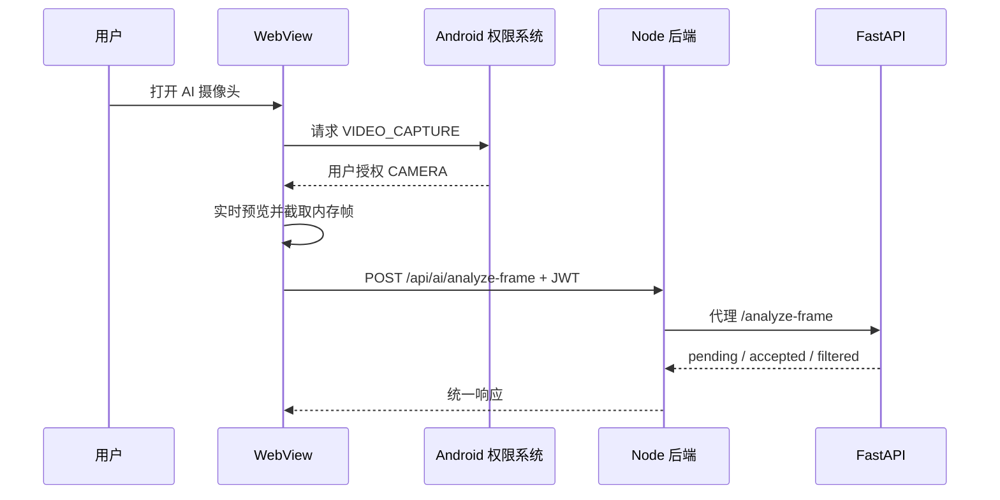

# Android 客户端架构设计

## 1 设计目标

Android 工程作为原课堂情绪系统的移动客户端，不嵌入 Node.js、SQLite、DeepFace 或模型文件。业务规则和数据仍由原后端统一处理，避免形成两套权限和数据实现。

## 2 组件结构

## 3 模块职责

| 模块 | 职责 |
|---|---|
| `MainActivity` | WebView 生命周期、加载状态、错误页、返回键、刷新和服务器设置 |
| `ServerUrl` | 地址规范化、格式校验和同源判断 |
| `ClassroomWebViewClient` | 仅在应用内加载同源页面，外部链接交给系统浏览器 |
| `ClassroomChromeClient` | 把 Web `getUserMedia` 请求映射到 Android 摄像头运行时权限 |
| `AndroidBridge` | 接收 Web Blob 的 Base64 数据并保存 CSV |
| SharedPreferences | 保存用户选择的服务器根地址，不保存账号密码 |

## 4 安全边界

- WebView 只向配置服务器同源页面授予摄像头权限；
- 仅允许视频采集，不授予麦克风资源；
- 外部页面不在带 JavaScript Bridge 的 WebView 中加载；
- SSL 校验使用 WebView 系统默认行为，不忽略证书错误；
- 原系统 JWT 仍保存在 WebView 的同源 LocalStorage 中；
- Android 工程不直接访问 SQLite，也不持有 AI 服务令牌；
- 生产部署使用 HTTPS，局域网 HTTP 仅用于实验环境。

## 5 数据流

### 5.1 普通业务

WebView 加载原前端，注册、登录、emoji、历史、统计和管理请求与浏览器版本完全相同。后端继续执行 JWT、RBAC、排课关系和教师课堂归属校验。

### 5.2 摄像头

### 5.3 CSV

原网页生成 Blob URL 后，Android 注入脚本读取 Blob，调用 `EmojiAndroid.saveBase64File`。Android 10 及以上保存到系统 `下载/EmojiClassroom`；旧版本保存到应用专属下载目录。
