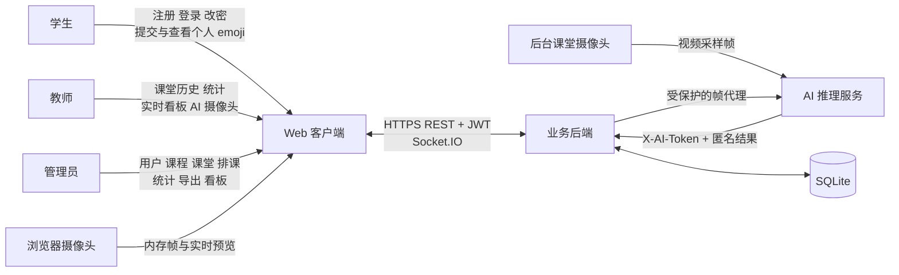
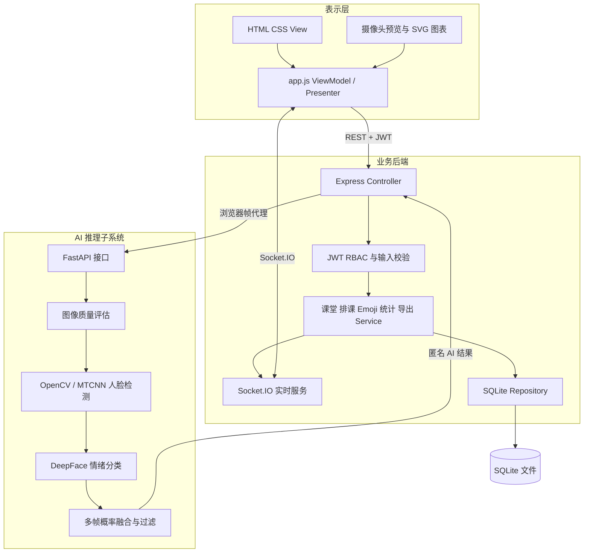
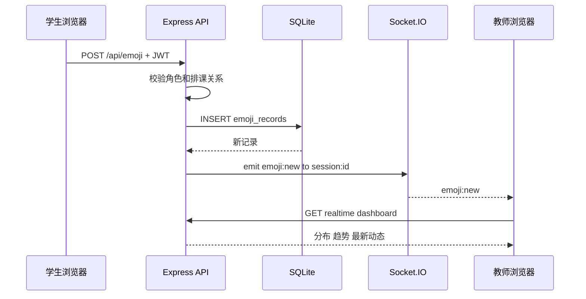
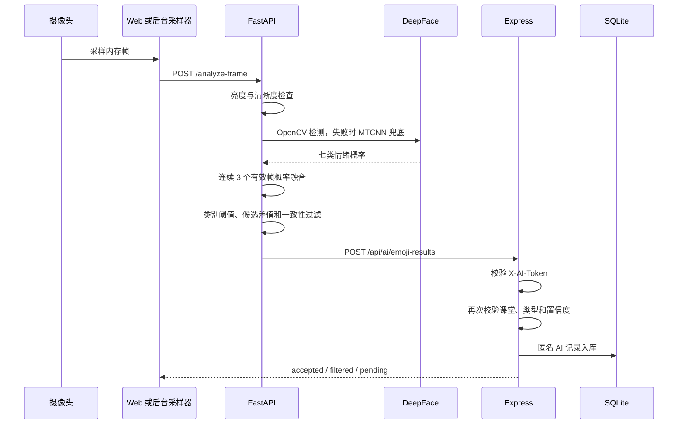
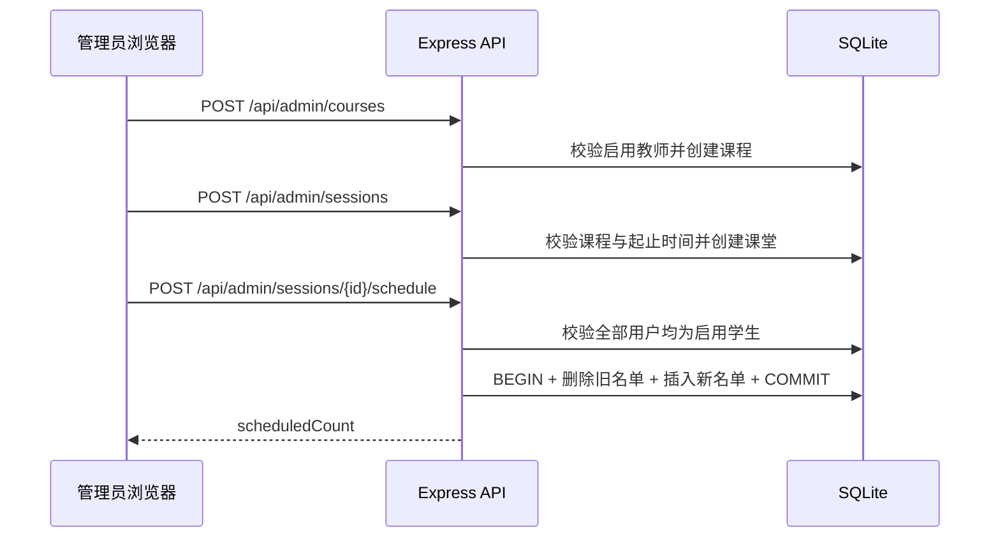
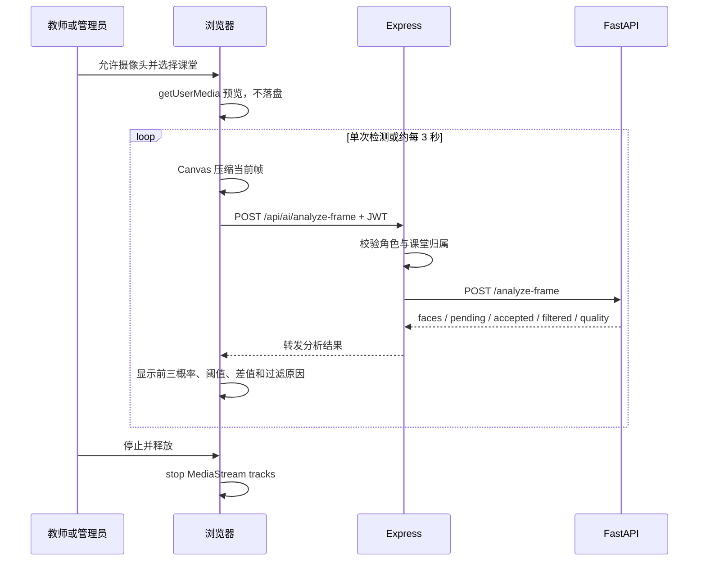
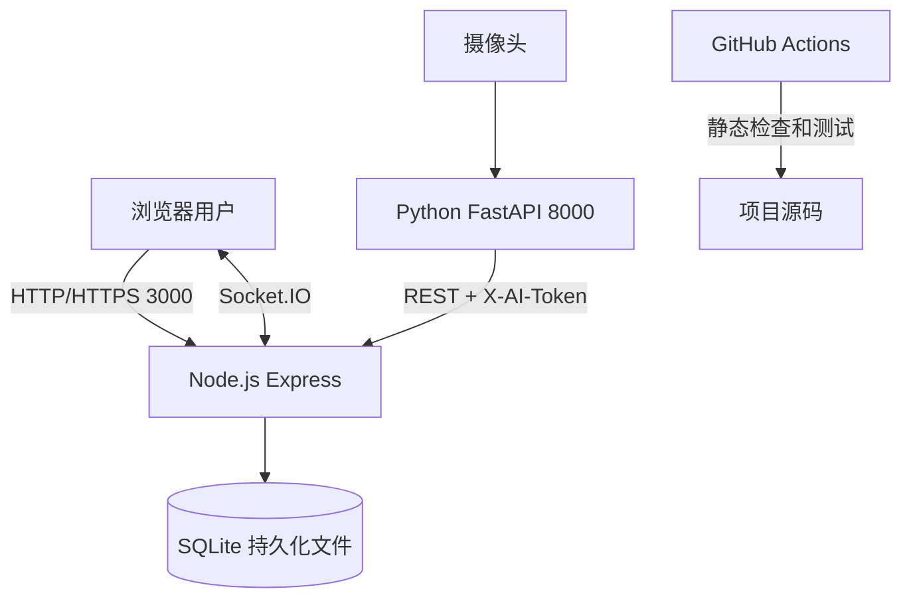

# 系统设计文档

## 1 总体架构

系统采用 B/S 为主、独立 AI 服务协同的修改版 MVC 架构。学生、教师和管理员统一使用浏览器客户端；Express 提供 REST API、认证授权、业务规则和 Socket.IO 实时通信；SQLite 持久化业务数据；FastAPI 负责摄像头帧的人脸检测与表情分类。AI 服务不直接访问数据库，所有结果必须经过后端令牌、阈值和课堂有效性校验后入库。

### 1.1 系统上下文图



### 1.2 分层组件架构



### 1.3 修改版 MVC 映射

| 层次 | 实现 | 职责 |
|---|---|---|
| View | `public/index.html`、`public/styles.css` | 页面结构、表单、表格、状态卡片、摄像头画面和统计图容器 |
| ViewModel/Presenter | `public/app.js` | 保存登录态和页面状态，调用 API，渲染角色界面、SVG 图表和摄像头反馈 |
| Controller | `server/app.js` 中的 Express 路由 | 接收请求、解析参数、调用认证及业务规则、组织统一响应 |
| Service | `server/app.js` 中的认证、权限、统计、导出和课堂归属逻辑 | 执行 RBAC、排课校验、教师数据边界、聚合统计和安全导出 |
| Repository | `server/db.js` 与参数化 SQL | 建表、事务、索引、查询和持久化 |
| Realtime Adapter | `server/realtime.js` | JWT 握手、课堂房间授权和 `emoji:new` 广播 |
| AI Service | `ai-service/main.py` | 解码帧、质量检查、人脸检测、情绪分类、多帧融合、阈值过滤和结果提交 |

修改版 MVC 的核心变化是加入 ViewModel/Presenter、Service、Repository、实时适配器和独立 AI 服务。这样既保留 MVC 的职责分离，又能处理单页界面状态、实时消息和计算密集型 AI 推理。

## 2 领域模型与 ER 图

```mermaid
erDiagram
  USER ||--o{ COURSE : teaches
  COURSE ||--o{ CLASS_SESSION : contains
  USER ||--o{ SCHEDULE_USER : scheduled
  CLASS_SESSION ||--o{ SCHEDULE_USER : includes
  USER o|--o{ EMOJI_RECORD : submits
  CLASS_SESSION ||--o{ EMOJI_RECORD : receives
  USER o|--o{ AUDIT_LOG : creates

  USER {
    integer id PK
    text username UK
    text password_hash
    text role
    text email UK
    text status
    text created_at
  }
  COURSE {
    integer id PK
    text name
    integer teacher_id FK
    text created_at
  }
  CLASS_SESSION {
    integer id PK
    integer course_id FK
    text starts_at
    text ends_at
    text classroom
    text class_name
    text created_at
  }
  SCHEDULE_USER {
    integer id PK
    integer session_id FK
    integer user_id FK
    text scheduled_at
  }
  EMOJI_RECORD {
    integer id PK
    integer user_id FK nullable
    integer session_id FK
    text emoji_type
    text recorded_at
    text source
    real confidence nullable
    text device_id
  }
  AUDIT_LOG {
    integer id PK
    integer user_id FK nullable
    text action
    text details
    text ip_address
    text created_at
  }
```

数据库建表语句见 [database-schema.sql](database-schema.sql)。

### 2.1 实体关系与基数说明

| 关系 | 基数 | 业务含义 | 完整性规则 |
|---|---|---|---|
| User—Course | 1:N | 一名教师可以负责多门课程，每门课程只有一名教师 | 创建课程时校验目标用户为启用教师 |
| Course—ClassSession | 1:N | 一门课程可在不同时间、班级和教室开设多次课堂 | 删除课程级联删除所属课堂 |
| User—ClassSession | M:N | 学生可参加多个课堂，课堂可包含多个学生 | 通过 `schedule_users` 关联，课堂与学生组合唯一 |
| ClassSession—EmojiRecord | 1:N | 每条手动或 AI 情绪记录属于一个课堂 | 删除课堂级联删除记录 |
| User—EmojiRecord | 0..1:N | 手动记录关联学生；匿名 AI 记录不关联用户 | 删除用户时 `user_id` 置空以保留聚合数据 |
| User—AuditLog | 0..1:N | 登录、改密和管理操作可关联操作者 | 用户删除后日志操作者置空 |

`schedule_users` 是排课关联实体，不把学生列表直接存入课堂字段；`emoji_records` 统一承载手动与 AI 数据，通过 `source`、`confidence` 和可空 `user_id` 区分来源与匿名性。

## 3 核心交互设计

### 3.1 学生提交与教师实时刷新



### 3.2 AI 结果入库



### 3.3 管理员创建课堂并安排名单



排课接口采用“完整替换”语义。任何无效学生都会使操作在写入前失败；事务保证不会出现只删除旧名单但未写入新名单的中间状态。

### 3.4 浏览器摄像头预览与帧代理



## 4 权限设计

| 资源 | 学生 | 教师 | 管理员 | AI 服务 |
|---|---|---|---|---|
| 本人资料与改密 | 本人 | 本人 | 本人 | 无 |
| 课堂列表 | 已排课 | 本人授课 | 全部 | 无 |
| 手动提交 | 已排课课堂 | 禁止 | 禁止 | 禁止 |
| 历史和统计 | 本人记录 | 本人课堂 | 全部 | 无 |
| 用户课程排课 | 禁止 | 禁止 | 允许 | 无 |
| AI 入库 | 禁止 | 禁止 | 禁止 | 独立令牌允许 |

JWT 每次请求都重新查询账号状态，因此管理员停用账号后，旧令牌立即失效。Socket.IO 握手和加入课堂房间时也进行身份及课堂归属校验。

## 5 统计与趋势设计

- 基础统计按 emoji 分组计算数量、百分比和 AI 平均置信度。
- 多维统计可组合课程、班级、开始时间和结束时间。
- 课堂样本量的时间过滤放在 `LEFT JOIN` 条件中，使无样本课堂仍可显示为 0。
- 趋势按 ISO 时间的分钟桶聚合，前端使用 SVG 绘制六条情绪折线。
- 教师查询自动追加 `teacher_id` 条件，不能通过修改查询参数越权。

## 6 安全与隐私设计

- bcrypt 成本因子 12。
- SQL 全部使用预编译参数，不拼接用户值。
- Zod 校验 ID、枚举、时间、密码和数据长度。
- Helmet、CORS、JSON 大小限制和认证限流。
- CSV 危险前缀转义。
- AI 服务令牌与用户 JWT 分离。
- AI 默认匿名，不保存帧；日志不记录图像内容。
- 关键操作写入审计日志。

## 7 部署设计

本机模式下，Express 监听 3000，FastAPI 监听 8000，SQLite 位于 `data/`。容器模式下，两个服务通过 Compose 网络通信，数据库文件保存在 `emoji-data` 命名卷。详细命令见 [部署说明](deployment.md)。

## 8 已知限制

- SQLite 和 Node 内置 SQLite API 适合课程实验与单机部署，大规模并发应迁移到 PostgreSQL 或 MySQL。
- DeepFace 首次安装和模型下载耗时较长，推理速度受硬件影响。
- 面部表情不是心理状态的可靠替代指标，结果只能用于课堂整体趋势辅助。
- 当前实时通信采用单实例内存房间，多实例部署需增加 Redis Adapter。

## 9 模块详细设计

| 模块 | 主要职责 | 输入 | 输出 | 异常处理 |
|---|---|---|---|---|
| Web View | 展示页面、表格、统计图和表单 | 用户操作、ViewModel 状态 | 可视化界面 | 显示统一中文错误提示 |
| 前端状态控制 | 保存 JWT、当前角色、筛选条件和页面状态 | 表单与 API 响应 | REST 请求、DOM 更新 | 401 时清理登录状态 |
| 认证控制器 | 注册、登录、改密、JWT 校验 | 用户凭据、Bearer Token | 用户信息和令牌 | 400/401/403/409 |
| 课程课堂控制器 | 课程、会话和排课维护 | 课程与排课参数 | 课堂和名单数据 | 校验教师、学生与时间范围 |
| Emoji 控制器 | 手动和 AI 记录写入、历史查询 | emoji、课堂、来源 | 记录或统计结果 | 校验角色、排课、阈值和令牌 |
| 统计服务 | 分布、课堂样本、分钟趋势 | 课程、班级、时间筛选 | 聚合 JSON | 拒绝错误时间范围 |
| 导出服务 | 生成安全 CSV | 统计筛选条件 | UTF-8 CSV | 危险单元格转义并审计 |
| 实时服务 | 身份握手、课堂房间、消息广播 | JWT、课堂编号、记录事件 | `emoji:new` | 越权加入房间被拒绝 |
| AI 推理服务 | 采样、检测、分类、映射、提交 | 摄像头帧或上传图像 | AI 记录 | 低置信度过滤、失败重试 |
| 数据访问层 | 建表、索引、种子数据、参数化查询 | SQL 参数 | 结构化数据 | 开启外键，依赖数据库约束 |

## 10 修改版 MVC 详细说明

传统 MVC 常把页面、控制器和模型置于同一应用。本系统为了同时支持 Web、实时通信和独立 AI 服务，将其调整为“View + ViewModel/Presenter + Controller + Service + Repository”的分层形式：

1. View 只负责展示，不直接操作数据库。
2. `public/app.js` 兼具 ViewModel 和 Presenter 职责，维护当前用户、页面、筛选器和请求状态。
3. Express Controller 接受 HTTP 请求、调用认证和参数校验，并组织响应。
4. Service 规则目前以同文件内函数组织，负责 RBAC、课堂归属、统计筛选、CSV 安全等业务约束。
5. Repository 使用 Node SQLite 的预编译语句访问数据库，避免 SQL 注入。
6. AI 服务不直接连接数据库，只能通过受保护 API 提交结果，从而维持统一业务边界。

这种修改减少了小型实验项目的目录复杂度，同时保留了展示、业务和数据职责分离。若项目继续扩展，可将 `server/app.js` 中的控制器和服务拆分为独立模块。

## 11 数据库详细设计

### 11.1 数据表字典

| 表 | 主键 | 关键约束 | 用途 |
|---|---|---|---|
| `users` | `id` | 用户名和邮箱唯一；角色、状态枚举 | 保存账号和角色信息 |
| `courses` | `id` | `teacher_id` 外键 | 建立课程与教师关系 |
| `class_sessions` | `id` | `course_id` 外键 | 保存具体课堂时间、地点和班级 |
| `schedule_users` | `id` | 课堂和学生组合唯一 | 保存课堂学生名单 |
| `emoji_records` | `id` | emoji、来源检查；AI 必须有置信度 | 保存手动和 AI 情绪记录 |
| `audit_logs` | `id` | 操作者可空 | 保存关键安全与管理操作 |

### 11.2 字段级数据字典

| 表 | 字段 | 类型与约束 | 说明 |
|---|---|---|---|
| `users` | `username`、`email` | TEXT，非空，忽略大小写唯一 | 登录名与联系邮箱 |
| `users` | `password_hash` | TEXT，非空 | bcrypt 成本因子 12 的哈希，不保存明文密码 |
| `users` | `role` | STUDENT / TEACHER / ADMIN | RBAC 角色 |
| `users` | `status` | ACTIVE / DISABLED | 停用后登录和已有 JWT 均不可用 |
| `courses` | `teacher_id` | INTEGER，外键，非空 | 课程负责教师 |
| `class_sessions` | `starts_at`、`ends_at` | ISO 8601 TEXT，非空 | 课堂时间范围，业务层保证结束晚于开始 |
| `class_sessions` | `classroom`、`class_name` | TEXT，非空 | 教室和班级维度 |
| `schedule_users` | `session_id`、`user_id` | 外键，组合唯一 | 课堂与学生的多对多关联 |
| `emoji_records` | `emoji_type` | 六值枚举检查 | HAPPY、CALM、CONFUSED、SAD、ANGRY、SURPRISED |
| `emoji_records` | `source` | MANUAL / AI | 记录来源 |
| `emoji_records` | `confidence` | REAL，可空 | AI 记录必须非空；手动记录为空 |
| `emoji_records` | `device_id` | TEXT，可空 | 浏览器或摄像头逻辑标识，不保存图像 |
| `audit_logs` | `action`、`details` | TEXT | 操作名称与 JSON 详情 |
| `audit_logs` | `ip_address` | TEXT，可空 | 请求来源地址 |

### 11.3 索引设计

- `idx_emoji_session_time(session_id, recorded_at)`：支持课堂实时看板和趋势查询。
- `idx_emoji_user_time(user_id, recorded_at)`：支持学生个人历史。
- `idx_sessions_course_time(course_id, starts_at)`：支持课程及时间范围筛选。
- 用户名和邮箱唯一约束同时承担快速登录、查重功能。

### 11.4 完整性与删除规则

- 课程教师必须引用现有用户，并由业务层保证其角色是教师。
- 删除课堂时，排课和 emoji 记录通过级联规则一并处理。
- 删除用户时，排课关系级联删除，历史 emoji 的 `user_id` 置空，以保留匿名统计价值。
- `source=AI` 时数据库检查约束要求 `confidence` 不为空。

## 12 API 设计原则

- 统一前缀为 `/api`，请求和响应默认使用 JSON。
- 成功响应使用 `{ success: true, data: ... }`。
- 失败响应使用 `{ success: false, error: { code, message, details } }`。
- 用户接口使用 `Authorization: Bearer <JWT>`；AI 接口使用 `X-AI-Token`。
- 创建资源返回 201，参数错误返回 400，未认证返回 401，越权返回 403，不存在返回 404，冲突返回 409。
- 查询接口根据当前角色在服务端追加数据边界，禁止仅依赖前端隐藏功能。
- OpenAPI 契约由 `server/openapi.js` 提供，详细人工文档见 [API 接口文档](api-documentation.md)。

## 13 关键算法与业务规则

### 13.1 实时看板统计

1. 以当前时间向前取 15 分钟作为实时窗口。
2. 按 emoji 类型分组统计数量。
3. 样本最多的类型作为主导情绪。
4. `CONFUSED`、`SAD`、`ANGRY` 计入需关注反馈。
5. 来源为 AI 的记录单独计数。
6. 按分钟形成趋势点，并返回最新记录列表。

### 13.2 AI 情绪映射

| 模型标签 | 系统 emoji |
|---|---|
| happy | HAPPY |
| neutral | CALM |
| fear | CONFUSED |
| disgust、angry | ANGRY |
| sad | SAD |
| surprise | SURPRISED |

DeepFace 没有独立“困惑”类别，因此 `fear → CONFUSED` 只是课堂语境下的启发式候选映射，使用更高的类别阈值和候选差值要求。它不能证明学生真实困惑，也不能替代学生主动提交。

每个有效人脸帧保留七类归一化概率。系统按 `sessionId + deviceId` 建立短期缓冲区，收集连续 3 个有效人脸帧后对各类别概率取均值，再计算主类别、第二候选、二者差值和帧间一致率。依次执行以下过滤：

1. 极暗、过曝或严重模糊时返回 `LOW_IMAGE_QUALITY`；
2. 未收集满连续帧时返回 `pending`，不写入数据库；
3. 低于基础阈值与类别阈值的较大者时返回 `LOW_CONFIDENCE`；
4. 第一、第二候选差值不足时返回 `AMBIGUOUS`；
5. 多帧主类别一致率不足时返回 `UNSTABLE`；
6. 通过全部条件后映射 emoji，经 AI 独立令牌提交后端；后端再次执行阈值校验。

### 13.3 CSV 安全导出

导出使用与统计接口相同的筛选构造逻辑。所有以 `=`、`+`、`-`、`@` 开头的文本在前方增加单引号，避免 Excel 将其当作公式执行。文件使用 UTF-8 BOM，保证中文环境兼容。

### 13.4 异常处理与降级

| 场景 | 处理方式 | 对其他功能的影响 |
|---|---|---|
| JWT 缺失、失效或账号停用 | 返回 401，前端清理登录状态 | 不影响公开健康检查和登录 |
| 角色或课堂范围越权 | 返回 403，不执行数据库写入 | 合法用户流程正常 |
| 参数、时间或枚举错误 | Zod/Pydantic 返回 400 | 不产生部分数据 |
| AI 服务不可用 | Web 帧代理返回 502 | 手动 emoji、历史、统计仍可用 |
| 未安装 OpenCV/DeepFace | AI 视觉接口返回 503 | `/health` 与 `/simulate` 仍可用 |
| 无人脸或帧数不足 | 返回空结果或 `pending` | 不写入错误记录 |
| 后端暂时不可用 | AI 最多重试 3 次并指数退避 | 原始帧不持久化 |
| 摄像头已被占用 | 后台任务无法打开设备或返回冲突 | 浏览器可释放设备后重试 |

## 14 部署拓扑



生产环境应在 Backend 前增加 HTTPS 反向代理，并限制 AI 端口只允许可信网络访问。Docker Compose 将后端和 AI 置于同一内部网络，SQLite 使用命名卷持久化。

## 15 设计到实现追踪

| 设计项 | 实现文件 | 验证方式 |
|---|---|---|
| MVC 与前端状态 | `public/index.html`、`public/app.js` | 三角色人工流程 |
| REST 控制器与业务规则 | `server/app.js` | T01-T16 |
| 数据模型和索引 | `server/db.js`、`docs/database-schema.sql` | 内存数据库测试、持久化检查 |
| 实时课堂房间 | `server/realtime.js` | T07 |
| OpenAPI | `server/openapi.js` | T11、Swagger 页面 |
| AI 推理 | `ai-service/main.py` | A01-A09、真实摄像头链路验证 |
| 容器部署 | `Dockerfile`、`docker-compose.yml` | Compose 配置解析与部署用例 TC-26 |
| CI | `.github/workflows/ci.yml` | GitHub Actions 执行记录 |
