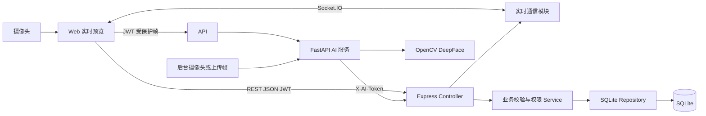
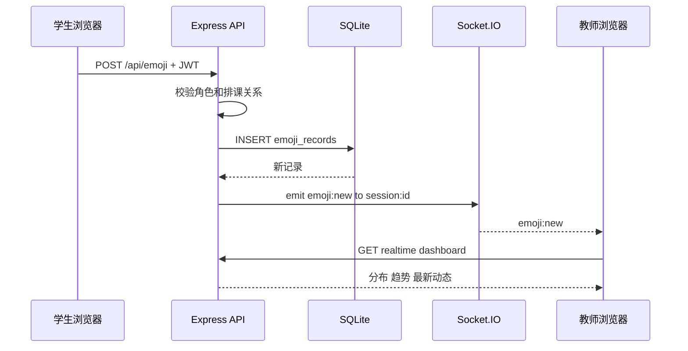
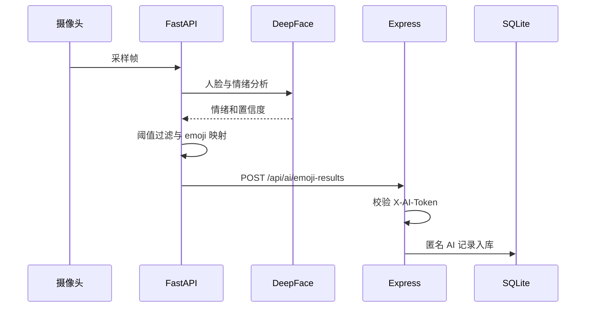
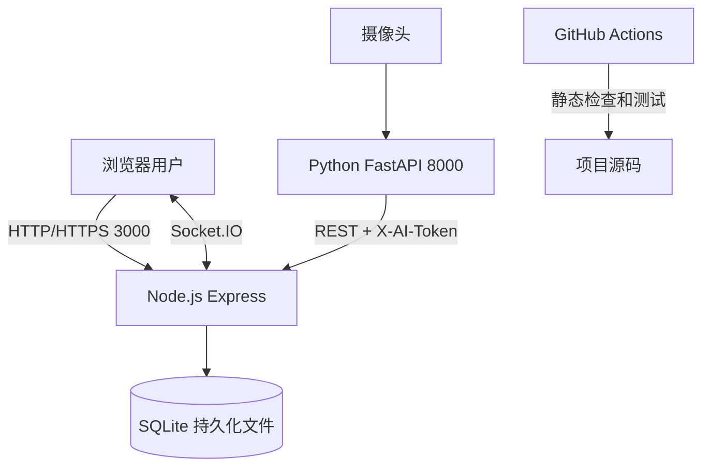

# 系统设计文档

## 1 总体架构

系统采用 C/S 与 B/S 结合的修改版 MVC。浏览器承担学生、教师和管理员客户端，Python 服务承担 AI 推理，Express 统一承载业务 API 和实时通信。



### 1.1 修改版 MVC 映射

- View：`public/index.html` 和 `public/styles.css`。
- ViewModel/Presenter：`public/app.js` 中的状态、导航、表单、图表和 API 调用。
- Controller：`server/app.js` 中的 Express 路由。
- Service：认证、RBAC、课堂归属、参数校验、统计和导出规则。
- Repository：预编译 SQLite SQL 和事务。
- AI 服务：独立 FastAPI 进程，通过统一 API 契约写入后端。

## 2 领域模型与 ER 图

```mermaid
erDiagram
  USER ||--o{ COURSE : teaches
  COURSE ||--o{ CLASS_SESSION : contains
  USER ||--o{ SCHEDULE_USER : scheduled
  CLASS_SESSION ||--o{ SCHEDULE_USER : includes
  USER o|--o{ EMOJI_RECORD : submits
  CLASS_SESSION ||--o{ EMOJI_RECORD : receives
  USER o|--o{ AUDIT_LOG : creates

  USER {
    integer id PK
    text username UK
    text password_hash
    text role
    text email UK
    text status
    text created_at
  }
  COURSE {
    integer id PK
    text name
    integer teacher_id FK
    text created_at
  }
  CLASS_SESSION {
    integer id PK
    integer course_id FK
    text starts_at
    text ends_at
    text classroom
    text class_name
  }
  SCHEDULE_USER {
    integer id PK
    integer session_id FK
    integer user_id FK
    text scheduled_at
  }
  EMOJI_RECORD {
    integer id PK
    integer user_id FK nullable
    integer session_id FK
    text emoji_type
    text recorded_at
    text source
    real confidence nullable
    text device_id
  }
  AUDIT_LOG {
    integer id PK
    integer user_id FK nullable
    text action
    text details
    text ip_address
    text created_at
  }
```

数据库建表语句见 [database-schema.sql](database-schema.sql)。

## 3 核心交互设计

### 3.1 学生提交与教师实时刷新



### 3.2 AI 结果入库



## 4 权限设计

| 资源 | 学生 | 教师 | 管理员 | AI 服务 |
|---|---|---|---|---|
| 本人资料与改密 | 本人 | 本人 | 本人 | 无 |
| 课堂列表 | 已排课 | 本人授课 | 全部 | 无 |
| 手动提交 | 已排课课堂 | 禁止 | 禁止 | 禁止 |
| 历史和统计 | 本人记录 | 本人课堂 | 全部 | 无 |
| 用户课程排课 | 禁止 | 禁止 | 允许 | 无 |
| AI 入库 | 禁止 | 禁止 | 禁止 | 独立令牌允许 |

JWT 每次请求都重新查询账号状态，因此管理员停用账号后，旧令牌立即失效。Socket.IO 握手和加入课堂房间时也进行身份及课堂归属校验。

## 5 统计与趋势设计

- 基础统计按 emoji 分组计算数量、百分比和 AI 平均置信度。
- 多维统计可组合课程、班级、开始时间和结束时间。
- 课堂样本量的时间过滤放在 `LEFT JOIN` 条件中，使无样本课堂仍可显示为 0。
- 趋势按 ISO 时间的分钟桶聚合，前端使用 SVG 绘制六条情绪折线。
- 教师查询自动追加 `teacher_id` 条件，不能通过修改查询参数越权。

## 6 安全与隐私设计

- bcrypt 成本因子 12。
- SQL 全部使用预编译参数，不拼接用户值。
- Zod 校验 ID、枚举、时间、密码和数据长度。
- Helmet、CORS、JSON 大小限制和认证限流。
- CSV 危险前缀转义。
- AI 服务令牌与用户 JWT 分离。
- AI 默认匿名，不保存帧；日志不记录图像内容。
- 关键操作写入审计日志。

## 7 部署设计

本机模式下，Express 监听 3000，FastAPI 监听 8000，SQLite 位于 `data/`。容器模式下，两个服务通过 Compose 网络通信，数据库文件保存在 `emoji-data` 命名卷。详细命令见 [部署说明](deployment.md)。

## 8 已知限制

- SQLite 和 Node 内置 SQLite API 适合课程实验与单机部署，大规模并发应迁移到 PostgreSQL 或 MySQL。
- DeepFace 首次安装和模型下载耗时较长，推理速度受硬件影响。
- 面部表情不是心理状态的可靠替代指标，结果只能用于课堂整体趋势辅助。
- 当前实时通信采用单实例内存房间，多实例部署需增加 Redis Adapter。

## 9 模块详细设计

| 模块 | 主要职责 | 输入 | 输出 | 异常处理 |
|---|---|---|---|---|
| Web View | 展示页面、表格、统计图和表单 | 用户操作、ViewModel 状态 | 可视化界面 | 显示统一中文错误提示 |
| 前端状态控制 | 保存 JWT、当前角色、筛选条件和页面状态 | 表单与 API 响应 | REST 请求、DOM 更新 | 401 时清理登录状态 |
| 认证控制器 | 注册、登录、改密、JWT 校验 | 用户凭据、Bearer Token | 用户信息和令牌 | 400/401/403/409 |
| 课程课堂控制器 | 课程、会话和排课维护 | 课程与排课参数 | 课堂和名单数据 | 校验教师、学生与时间范围 |
| Emoji 控制器 | 手动和 AI 记录写入、历史查询 | emoji、课堂、来源 | 记录或统计结果 | 校验角色、排课、阈值和令牌 |
| 统计服务 | 分布、课堂样本、分钟趋势 | 课程、班级、时间筛选 | 聚合 JSON | 拒绝错误时间范围 |
| 导出服务 | 生成安全 CSV | 统计筛选条件 | UTF-8 CSV | 危险单元格转义并审计 |
| 实时服务 | 身份握手、课堂房间、消息广播 | JWT、课堂编号、记录事件 | `emoji:new` | 越权加入房间被拒绝 |
| AI 推理服务 | 采样、检测、分类、映射、提交 | 摄像头帧或上传图像 | AI 记录 | 低置信度过滤、失败重试 |
| 数据访问层 | 建表、索引、种子数据、参数化查询 | SQL 参数 | 结构化数据 | 开启外键，依赖数据库约束 |

## 10 修改版 MVC 详细说明

传统 MVC 常把页面、控制器和模型置于同一应用。本系统为了同时支持 Web、实时通信和独立 AI 服务，将其调整为“View + ViewModel/Presenter + Controller + Service + Repository”的分层形式：

1. View 只负责展示，不直接操作数据库。
2. `public/app.js` 兼具 ViewModel 和 Presenter 职责，维护当前用户、页面、筛选器和请求状态。
3. Express Controller 接受 HTTP 请求、调用认证和参数校验，并组织响应。
4. Service 规则目前以同文件内函数组织，负责 RBAC、课堂归属、统计筛选、CSV 安全等业务约束。
5. Repository 使用 Node SQLite 的预编译语句访问数据库，避免 SQL 注入。
6. AI 服务不直接连接数据库，只能通过受保护 API 提交结果，从而维持统一业务边界。

这种修改减少了小型实验项目的目录复杂度，同时保留了展示、业务和数据职责分离。若项目继续扩展，可将 `server/app.js` 中的控制器和服务拆分为独立模块。

## 11 数据库详细设计

### 11.1 数据表字典

| 表 | 主键 | 关键约束 | 用途 |
|---|---|---|---|
| `users` | `id` | 用户名和邮箱唯一；角色、状态枚举 | 保存账号和角色信息 |
| `courses` | `id` | `teacher_id` 外键 | 建立课程与教师关系 |
| `class_sessions` | `id` | `course_id` 外键 | 保存具体课堂时间、地点和班级 |
| `schedule_users` | `id` | 课堂和学生组合唯一 | 保存课堂学生名单 |
| `emoji_records` | `id` | emoji、来源检查；AI 必须有置信度 | 保存手动和 AI 情绪记录 |
| `audit_logs` | `id` | 操作者可空 | 保存关键安全与管理操作 |

### 11.2 索引设计

- `idx_emoji_session_time(session_id, recorded_at)`：支持课堂实时看板和趋势查询。
- `idx_emoji_user_time(user_id, recorded_at)`：支持学生个人历史。
- `idx_sessions_course_time(course_id, starts_at)`：支持课程及时间范围筛选。
- 用户名和邮箱唯一约束同时承担快速登录、查重功能。

### 11.3 完整性与删除规则

- 课程教师必须引用现有用户，并由业务层保证其角色是教师。
- 删除课堂时，排课和 emoji 记录通过级联规则一并处理。
- 删除用户时，排课关系级联删除，历史 emoji 的 `user_id` 置空，以保留匿名统计价值。
- `source=AI` 时数据库检查约束要求 `confidence` 不为空。

## 12 API 设计原则

- 统一前缀为 `/api`，请求和响应默认使用 JSON。
- 成功响应使用 `{ success: true, data: ... }`。
- 失败响应使用 `{ success: false, error: { code, message, details } }`。
- 用户接口使用 `Authorization: Bearer <JWT>`；AI 接口使用 `X-AI-Token`。
- 创建资源返回 201，参数错误返回 400，未认证返回 401，越权返回 403，不存在返回 404，冲突返回 409。
- 查询接口根据当前角色在服务端追加数据边界，禁止仅依赖前端隐藏功能。
- OpenAPI 契约由 `server/openapi.js` 提供，详细人工文档见 [API 接口文档](api-documentation.md)。

## 13 关键算法与业务规则

### 13.1 实时看板统计

1. 以当前时间向前取 15 分钟作为实时窗口。
2. 按 emoji 类型分组统计数量。
3. 样本最多的类型作为主导情绪。
4. `CONFUSED`、`SAD`、`ANGRY` 计入需关注反馈。
5. 来源为 AI 的记录单独计数。
6. 按分钟形成趋势点，并返回最新记录列表。

### 13.2 AI 情绪映射

| 模型标签 | 系统 emoji |
|---|---|
| happy | HAPPY |
| neutral | CALM |
| fear、disgust | CONFUSED |
| sad | SAD |
| angry | ANGRY |
| surprise | SURPRISED |

映射完成后先进行置信度过滤，再提交后端。后端再次执行阈值校验，避免绕过 AI 服务直接写入低质量结果。

### 13.3 CSV 安全导出

导出使用与统计接口相同的筛选构造逻辑。所有以 `=`、`+`、`-`、`@` 开头的文本在前方增加单引号，避免 Excel 将其当作公式执行。文件使用 UTF-8 BOM，保证中文环境兼容。

## 14 部署拓扑



生产环境应在 Backend 前增加 HTTPS 反向代理，并限制 AI 端口只允许可信网络访问。Docker Compose 将后端和 AI 置于同一内部网络，SQLite 使用命名卷持久化。

## 15 设计到实现追踪

| 设计项 | 实现文件 | 验证方式 |
|---|---|---|
| MVC 与前端状态 | `public/index.html`、`public/app.js` | 三角色人工流程 |
| REST 控制器与业务规则 | `server/app.js` | T01-T14 |
| 数据模型和索引 | `server/db.js`、`docs/database-schema.sql` | 内存数据库测试、持久化检查 |
| 实时课堂房间 | `server/realtime.js` | T07 |
| OpenAPI | `server/openapi.js` | T11、Swagger 页面 |
| AI 推理 | `ai-service/main.py` | A01-A06、现场摄像头测试 |
| 容器部署 | `Dockerfile`、`docker-compose.yml` | Docker 现场启动 |
| CI | `.github/workflows/ci.yml` | GitHub Actions 执行记录 |
