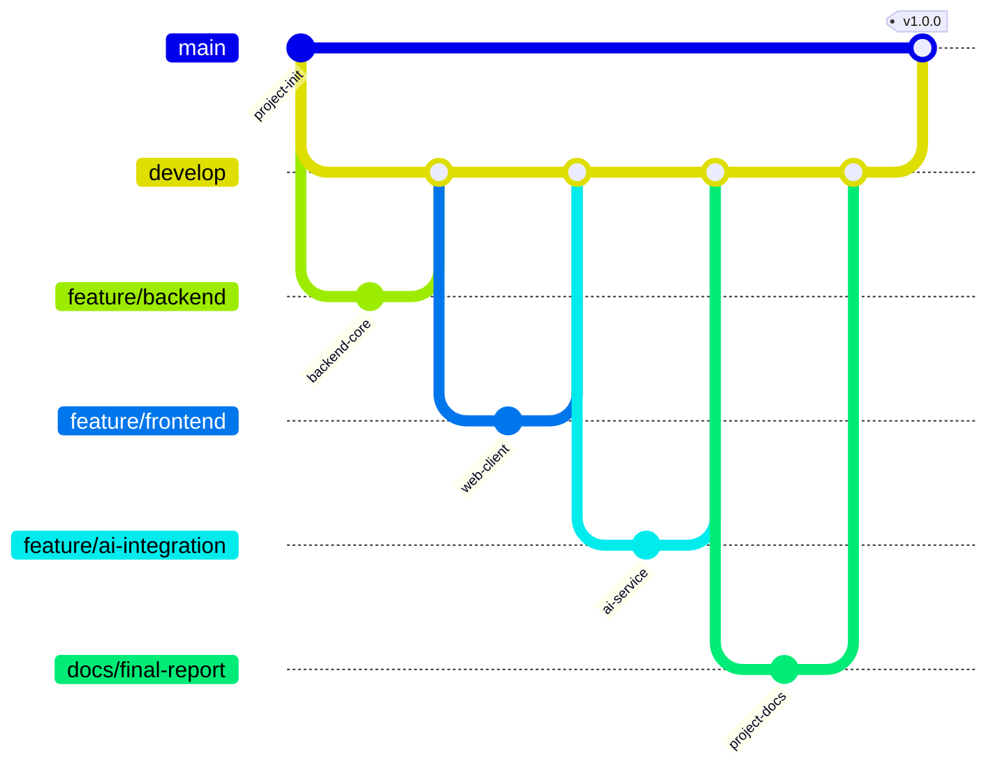

# 版本控制记录

## 1 仓库信息

| 项目 | 内容 |
|---|---|
| 代码托管平台 | GitHub |
| 仓库地址 | `https://github.com/Qian122/emoji.git` |
| 主分支 | `main` |
| 开发分支 | `develop` |
| 功能分支 | `feature/backend`、`feature/frontend`、`feature/ai-integration`、`docs/final-report` |
| 发布标签 | `v1.0.0` |

## 2 分支管理

`main` 保存稳定版本，`develop` 用于集成，功能和文档在独立分支完成后合并到 `develop`，测试通过后合并到 `main`。

## 3 提交规范

| 类型 | 用途 | 示例 |
|---|---|---|
| feat | 新功能 | `feat: add multidimensional emotion statistics` |
| fix | 缺陷修复 | `fix: restrict teacher session access` |
| test | 测试 | `test: cover ai confidence threshold` |
| docs | 文档 | `docs: complete experiment documentation` |
| refactor | 代码重构 | `refactor: extract statistics query builder` |
| ci | CI 配置 | `ci: add node and python workflow` |
| chore | 工程维护 | `chore: configure project repository` |

## 4 版本内容

### v1.0.0

- 完成学生、教师、管理员三类 Web 客户端。
- 完成注册、登录、修改密码、JWT 和 RBAC。
- 完成课程、课堂会话和排课名单管理。
- 完成学生 emoji、个人历史、教师课堂历史与统计。
- 完成实时课堂看板和多维统计图表。
- 完成 CSV 安全导出。
- 完成 OpenCV/DeepFace AI 推理服务、阈值过滤和匿名入库。
- 完成 OpenAPI、自动化测试、Docker Compose 和 CI。
- 完成需求、设计、测试、部署、用户手册和实验报告。

## 5 主要提交记录

| 提交 | 内容 |
|---|---|
| `a04ab72` | Initial commit |
| `080ba44` | 后端认证、权限、课堂服务和测试 |
| `fd6ebff` | 后端功能合并到 develop |
| `420072c` | 三角色 Web 客户端和看板 |
| `296b2a9` | Web 客户端合并到 develop |
| `3e58706` | AI 推理、Docker 和 CI |
| `c9f4671` | AI 与部署功能合并到 develop |
| `8adb3c6` | 实验文档和团队记录 |
| `378495d` | 文档合并到 develop |
| `63f6ea3` | v1.0.0 发布合并 |

## 6 仓库内容控制

`.gitignore` 排除以下运行期或敏感内容：

- `.env`
- `node_modules/`
- `data/`
- `*.log`
- Python 缓存和虚拟环境
- DeepFace 模型缓存

仓库保留 `.env.example`，用于说明环境变量名称和默认配置结构。
